# A Place Beyond — PSP edition

A dark, hand-painted action adventure, ported to the **Sony PSP** from the web game *A Place Beyond*.

Walk the forest road to Blackwater Parish, row the drowned lake, light the lanterns of the Mire, hunt the Vesper Count
through the city, wake the Pale Bell — then take the four journeys beyond: the dive down the pistol's muzzle, the
climb, the night drive over the pass, and the dragon's dream.

### ⬇️ [Download the latest release](../../releases/latest)

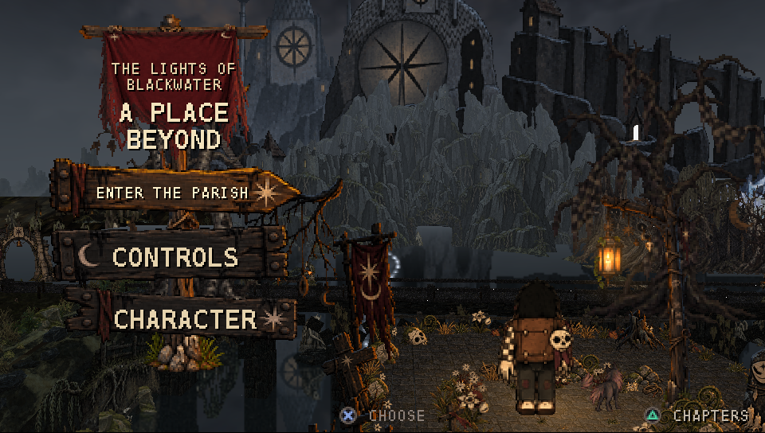

| | |
|---|---|
| 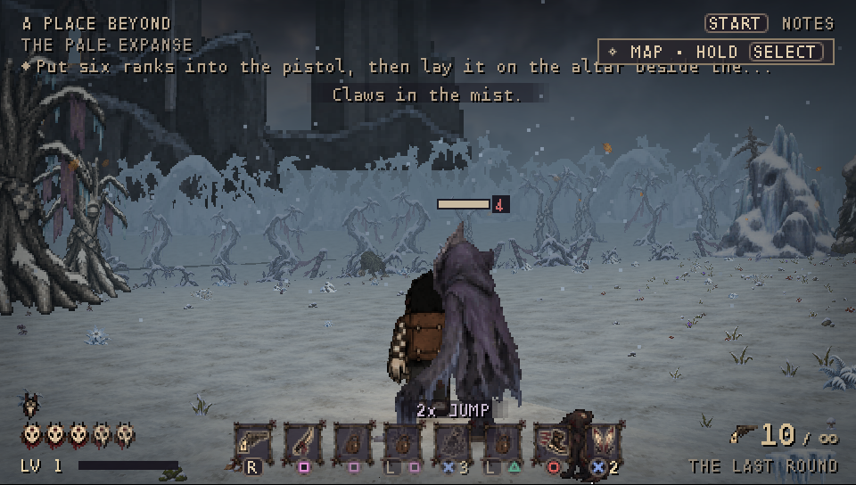 | 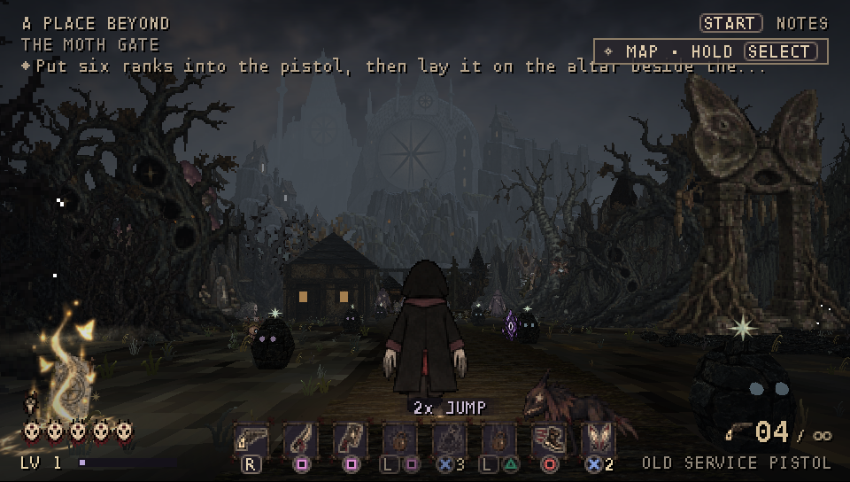 |
| 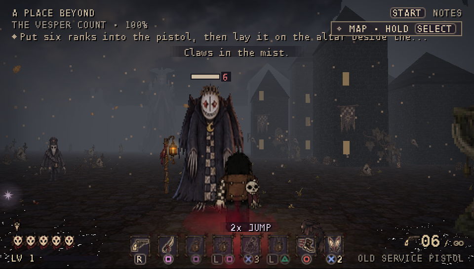 | 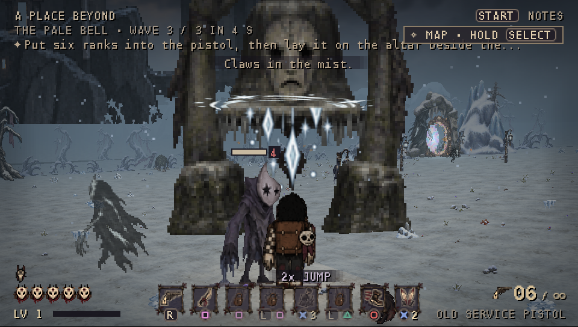 |
| 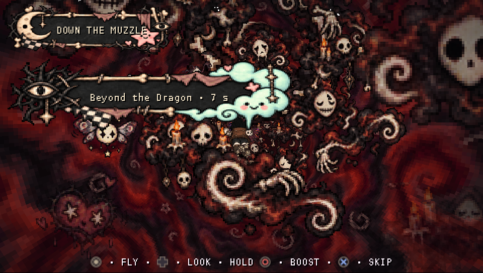 | 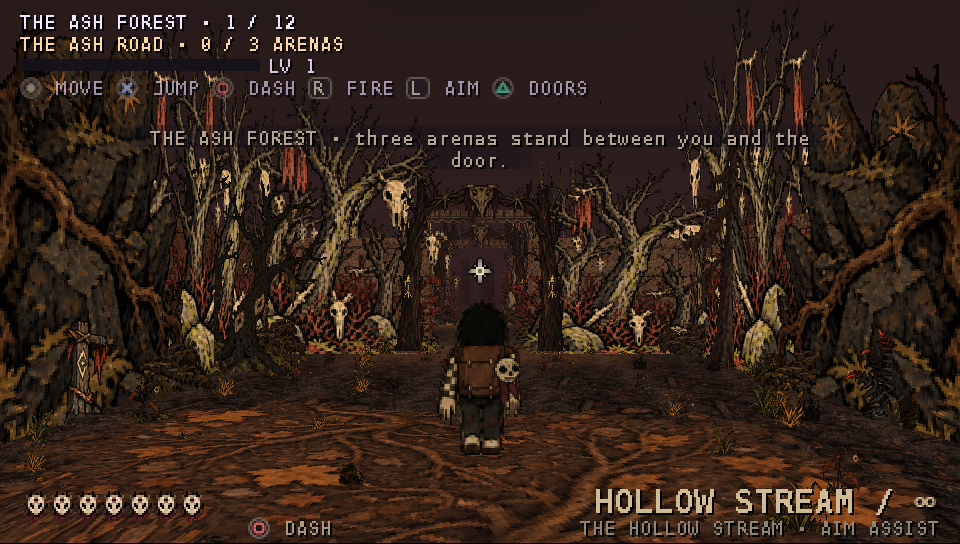 |
| 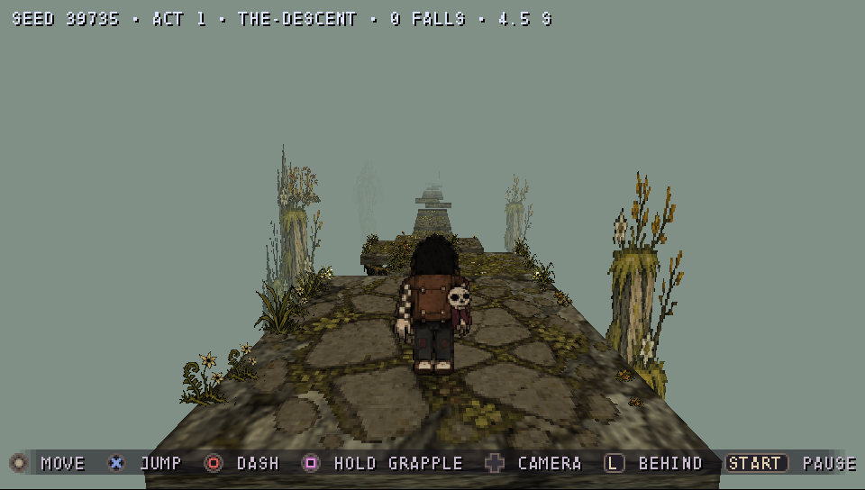 | 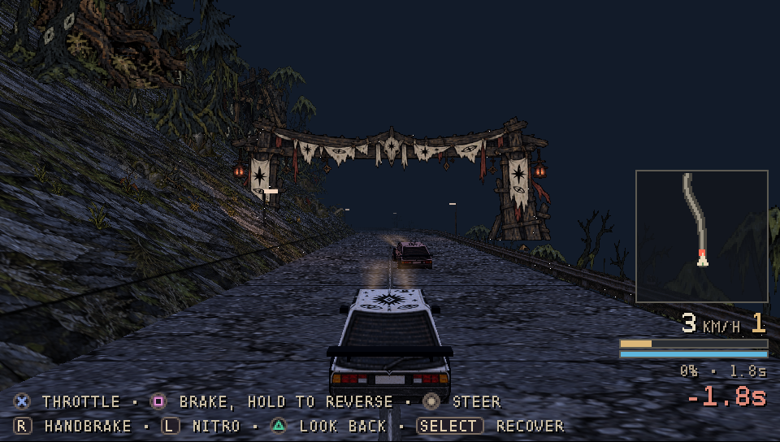 |
| 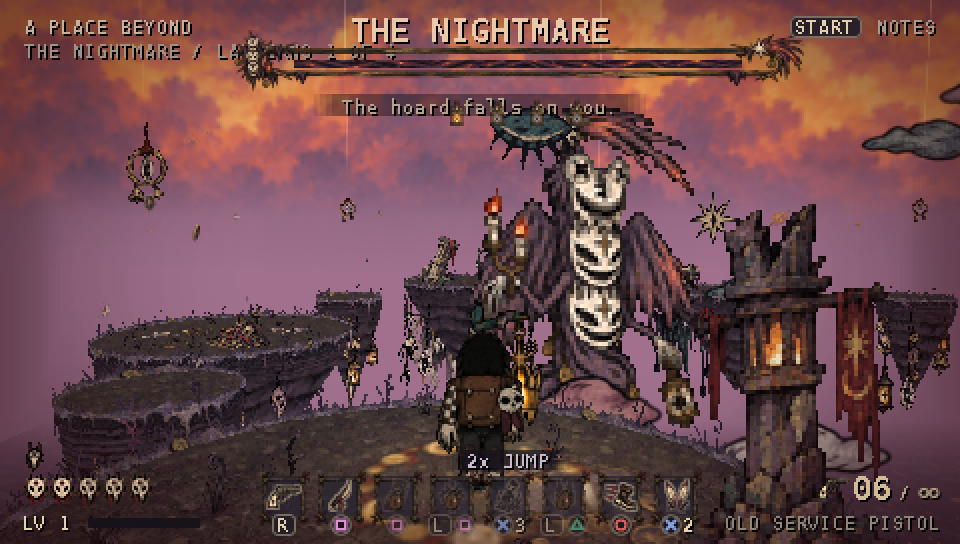 | 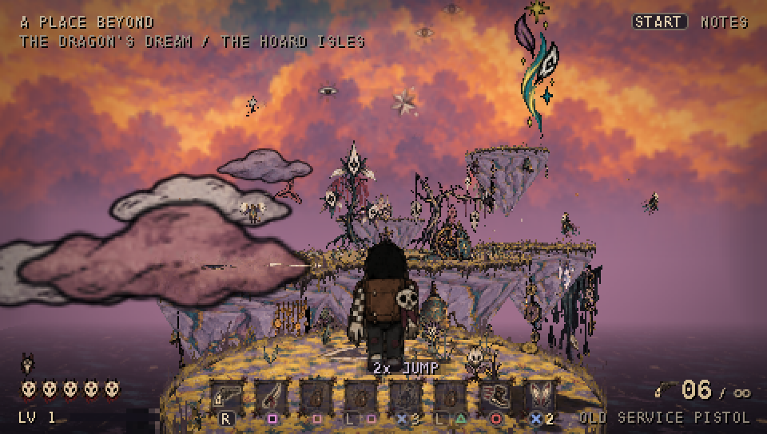 |
| 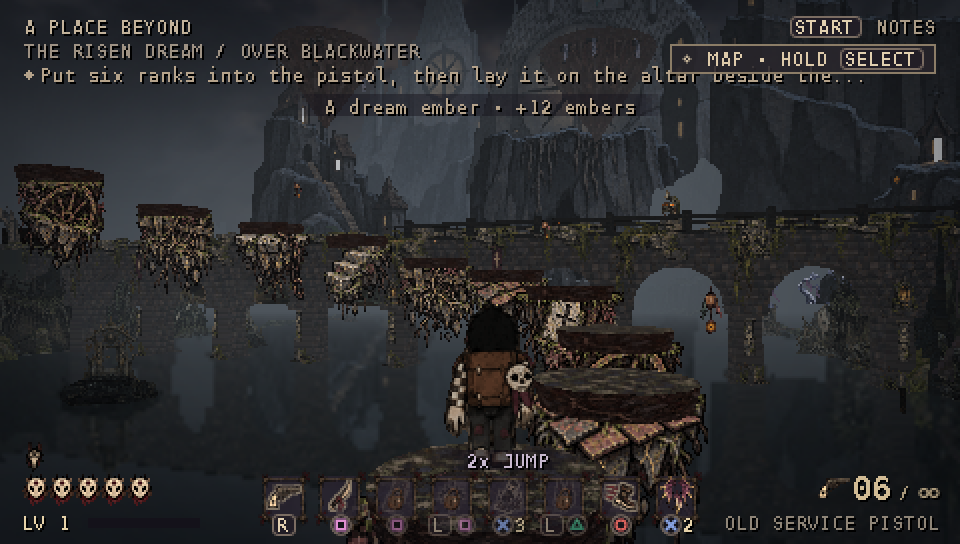 | 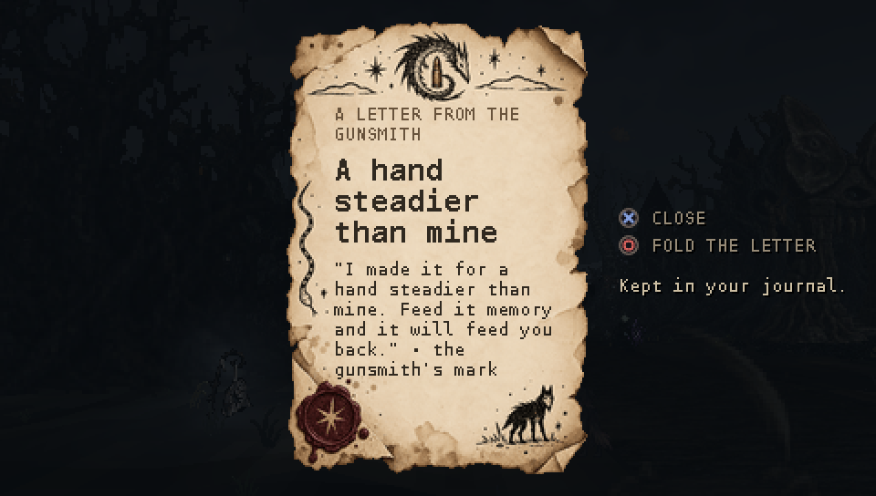 |

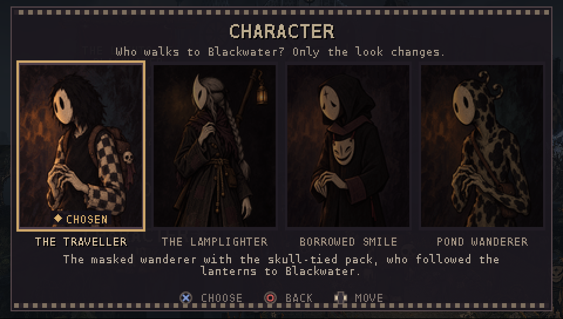

## Features

- The whole open world of stage one, with its bosses, quests, shrines and secrets
- Three journey stages: a twin-stick dive, a parkour climb and a night car race over the pass
- The dragon's dream: three acts of floating islands, the Nightmare, and dream wings to glide on
- Boss intros, letters on painted paper, and options for brightness, look speed and subtitles
- Upgrade tree, journal, map and four playable characters
- The original painted art, music and voice lines
- 30 fps on a real PSP-2000

## Requirements

- **PSP-2000, PSP-3000 or PSP Go** with custom firmware (PRO, ME, ARK-4 or ARK-5).
  Tested on a PSP-2000 with 6.61 PRO-C. The **PSP-1000 is not supported** (it lacks the extra memory).
- Players report it working on a **PS Vita with Adrenaline** and on Linux handhelds.
- **PPSSPP** on PC, Android and iOS works too.
- About 115 MB free on the memory stick.

## Install

Back up your memory stick first, as with any homebrew.

1. Download the latest zip from [Releases](../../releases/latest) (v0.9.1 or newer, **not** v0.9).
2. **From a computer (recommended):** unzip it and copy the `APlaceBeyond` folder into `PSP/GAME` on the memory stick.
   Eject safely before unplugging.
   **On the PSP with ARK's file manager:** copy the zip into `PSP/GAME`, extract it there, then delete the zip.
3. You should have `PSP/GAME/APlaceBeyond/EBOOT.PBP` and `PSP/GAME/APlaceBeyond/data/` (34 `.pak` files, all needed).
4. On the PSP: **Game › Memory Stick › A Place Beyond**. In PPSSPP, open the `EBOOT.PBP`.

**"Corrupted Data" in the XMB** means the folder is incomplete or in the wrong place. This happened with the v0.9 zip
when it was extracted with ARK's on-PSP unzipper. Remove the folder **from a computer**, then install the latest release. Never power
the PSP off while it is deleting or copying.

Updating: replace the `APlaceBeyond` folder; keep `data/save.bin` if you want your progress (saves from v0.9 and
v0.9.1 load in the latest version).

## Controls

| Button | Action |
|---|---|
| Analog stick | Move (push fully to run) |
| D-pad | Turn and tilt the camera |
| R / hold L | Fire the pistol / aim over the shoulder (tap L recentres the camera) |
| ✕ | Jump, double jump; hold in the air to glide (once you have the wings) |
| ○ | Dash |
| □ | Light cut; hold for the heavy cut · L + □: eye burst · in the air after a double jump: ground slam |
| △ | Interact, board the boat, reload · L + △: call the guardian hound |
| Select / hold Select | Upgrade tree / map |
| Start | Pause: journal, options, map |

On the title screen, △ opens **CHAPTERS** to jump straight into the journey stages or the dream. The release zip includes a cheat
menu (`CHEATS.txt`) for anyone who just wants to look around.

## Known issues (beta)

- The web version's companions (the party) are not in the PSP edition yet.
- The game saves at chimes, doors and the finale; the PSP may pause for a moment while it writes.
- Stage four sees half as far as the web version, to keep 30 fps on real hardware.
- The larger areas take a few seconds to load from a real Memory Stick.

Found a bug? Please open an [issue](../../issues) with your PSP model, firmware and what happened.

## Credits & license

*A Place Beyond* — game, art and design: **bcaa777**.
The PSP edition is built with the open [PSPSDK toolchain](https://github.com/pspdev); third-party notices are in the
release zip (`THIRD_PARTY_NOTICES.txt`).

The game and all its content are © bcaa777. It is free to download and play — please share a link to this page
rather than re-uploading the files.
