# A Place Beyond — PSP edition

A dark, hand-painted action adventure, ported to the **Sony PSP** from the web game
[*A Place Beyond*](https://bcaa777.itch.io/a-place-beyond). The original is on itch.io and plays free in your browser;
it is still in active development, so it is always the newest version, and this PSP edition follows it.

Walk the forest road to Blackwater Parish, row the drowned lake, light the lanterns of the Mire, hunt the Vesper Count
through the city, wake the Pale Bell — then take the five journeys beyond: the dive down the pistol's muzzle, the
climb, the night drive over the pass, the dragon's dream, and the Underparish.

> **Have a PS Vita?** There's a native Vita edition (960x544, sharper art, the companions) in testing:
> [A Place Beyond — PS Vita edition](https://github.com/bcaa777/a-place-beyond-psp-vita)

> **New from the same world: Beyond Hollow.** A 2.5D metroidvania where you play the companion dog. Play the original
> free in your browser on [itch.io](https://bcaa777.itch.io/beyondhollow), and now on the PSP too:
> [about the PSP edition](#beyond-hollow--psp-edition) · [download v0.9.1](../../releases/tag/beyond-hollow-v0.9.1)

### ⬇️ [Download the latest release](../../releases/latest)

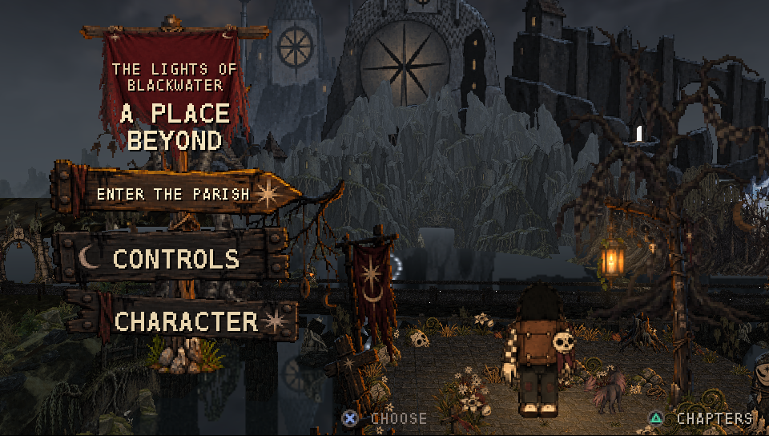

| | |
|---|---|
| 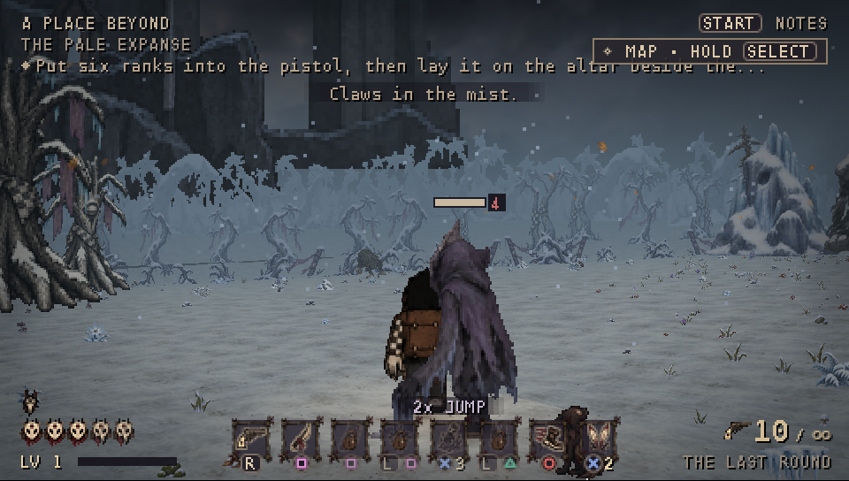 | 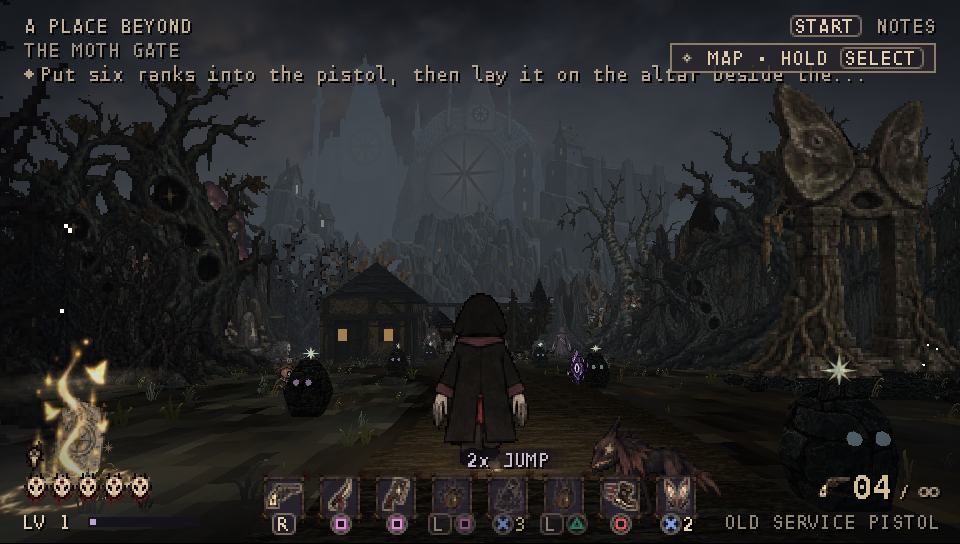 |
| 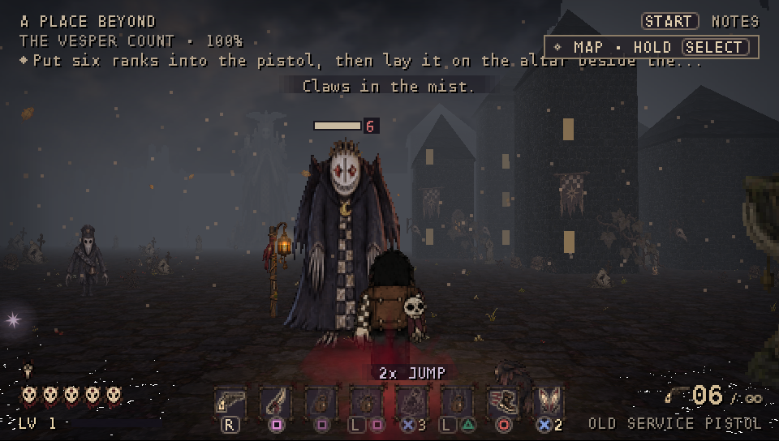 | 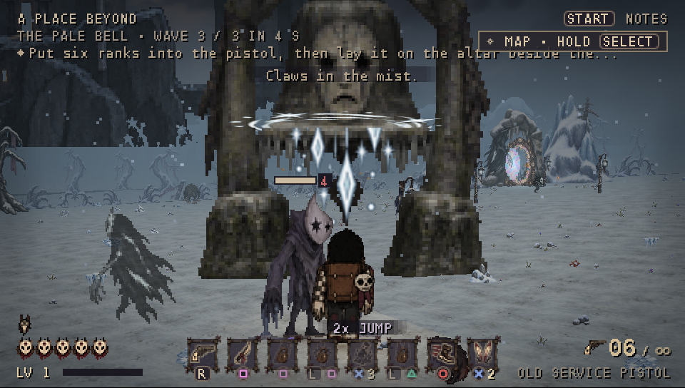 |
| 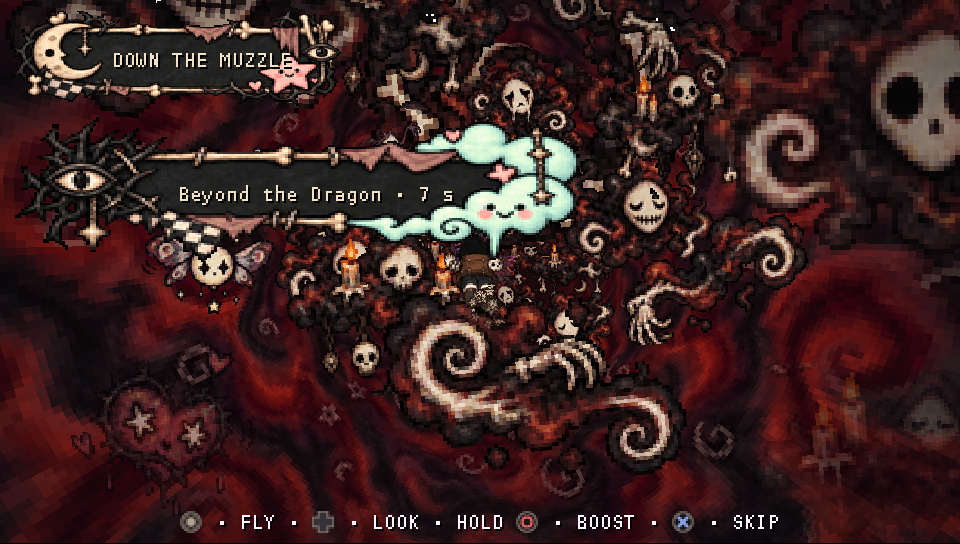 | 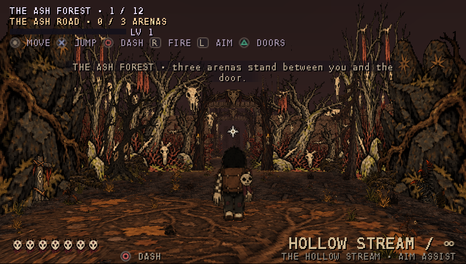 |
| 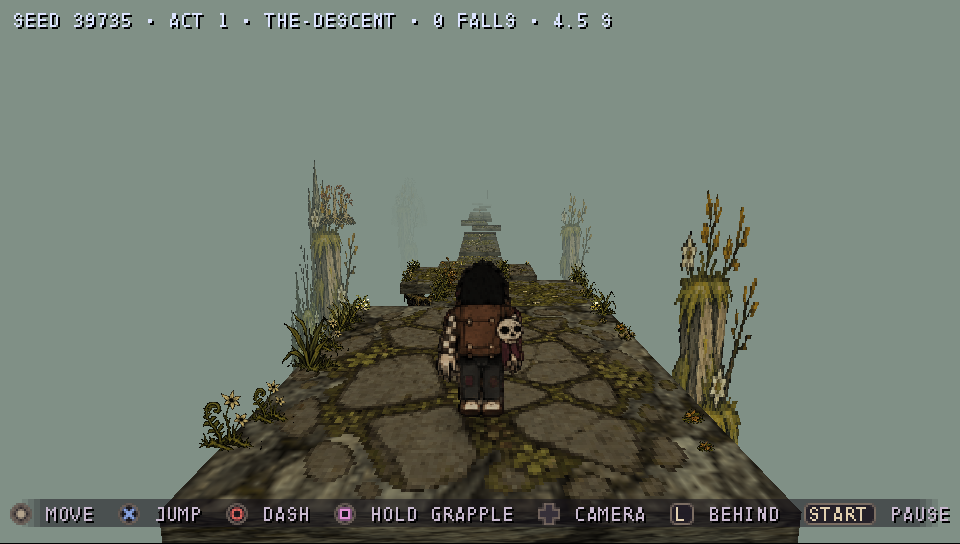 | 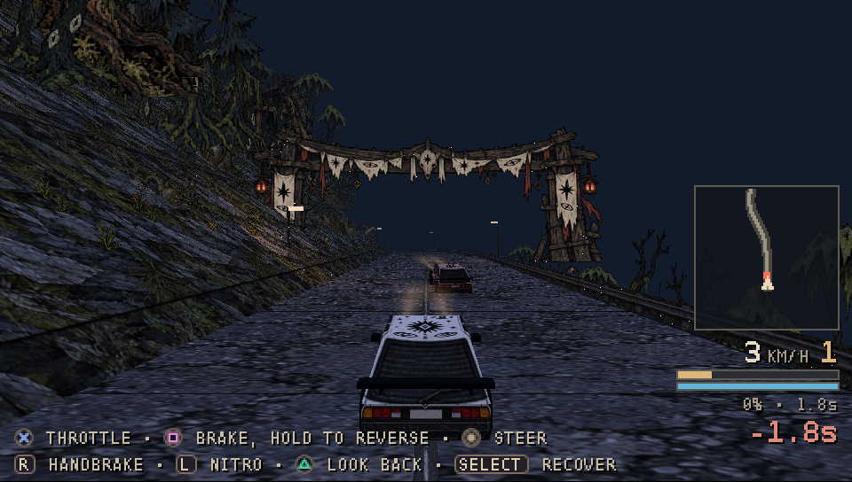 |
| 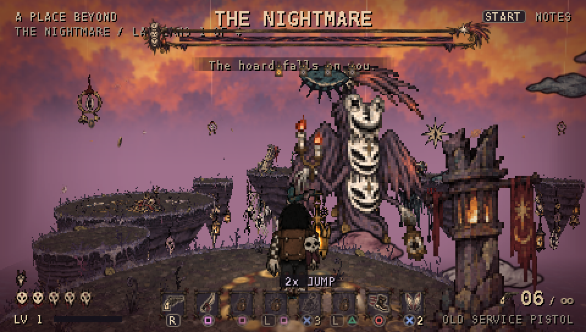 | 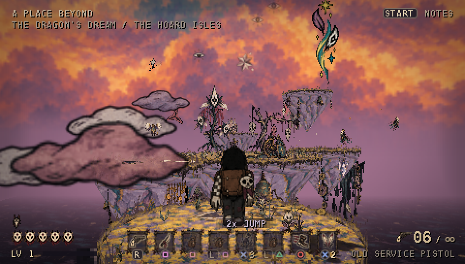 |
| 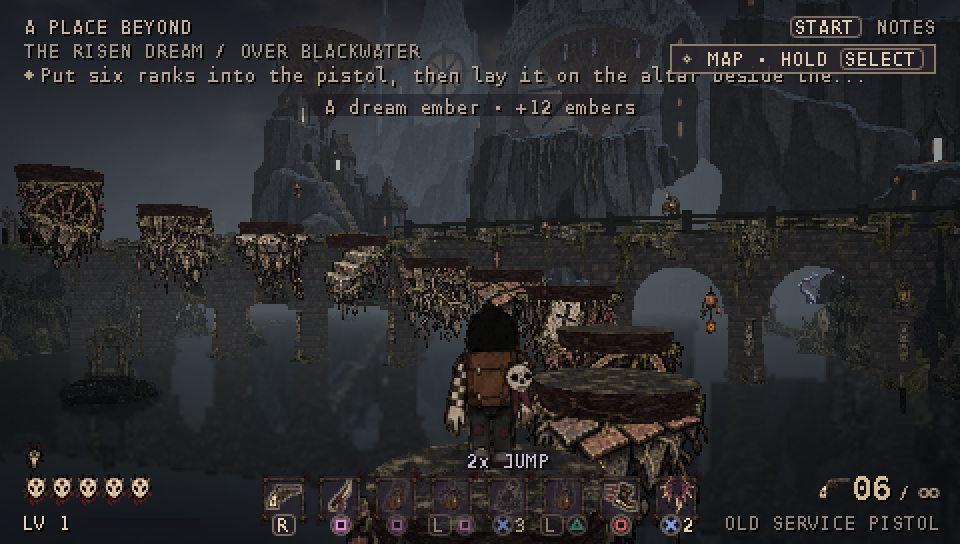 | 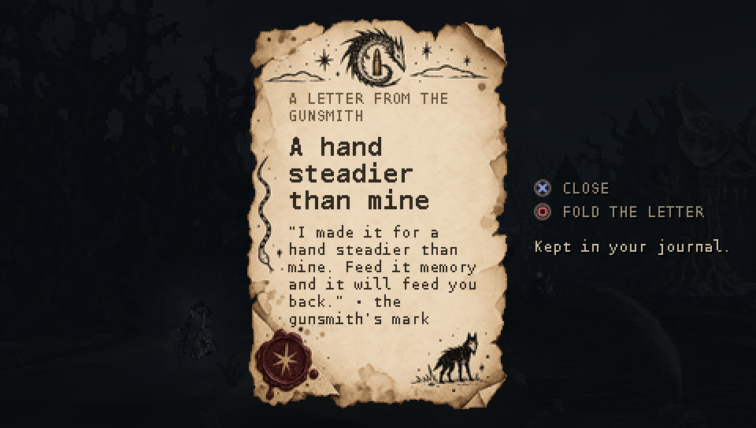 |

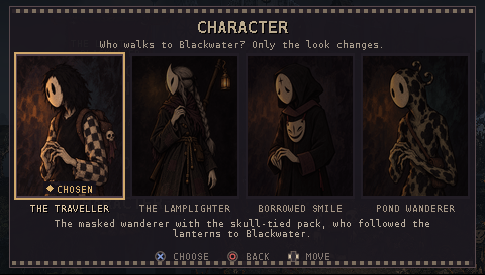

## Features

- The whole open world of stage one, with its bosses, quests, shrines and secrets
- Three journey stages: a twin-stick dive, a parkour climb and a night car race over the pass
- The dragon's dream: three acts of floating islands, the Nightmare, and dream wings to glide on
- The Underparish: three circles under a drowned Blackwater, their bosses, the Uncrowned Gate and the hell hound
- Boss intros, letters on painted paper, and options for brightness, look speed and subtitles
- Seven languages: English, Español, 日本語, 한국어, 简体中文, Українська, Русский (OPTIONS › LANGUAGE)
- Upgrade tree, journal, map and four playable characters
- The original painted art, music and voice lines
- 30 fps on a real PSP-2000

## Requirements

- **PSP-2000, PSP-3000 or PSP Go** with custom firmware (PRO, ME, ARK-4 or ARK-5).
  Tested on a PSP-2000 with 6.61 PRO-C. The **PSP-1000 is not supported** (it lacks the extra memory).
- Players report it working on a **PS Vita with Adrenaline** and on Linux handhelds. For the Vita there is also a
  [native PS Vita edition](https://github.com/bcaa777/a-place-beyond-psp-vita) in testing.
- **PPSSPP** on PC, Android and iOS works too.
- About 140 MB free on the memory stick.

## Install

Back up your memory stick first, as with any homebrew.

1. Download the latest zip from [Releases](../../releases/latest) (v0.9.1 or newer, **not** v0.9).
2. **From a computer (recommended):** unzip it and copy the `APlaceBeyond` folder into `PSP/GAME` on the memory stick.
   Eject safely before unplugging.
   **On the PSP with ARK's file manager:** copy the zip into `PSP/GAME`, extract it there, then delete the zip.
3. You should have `PSP/GAME/APlaceBeyond/EBOOT.PBP` and `PSP/GAME/APlaceBeyond/data/` (52 `.pak` files, all needed).
4. On the PSP: **Game › Memory Stick › A Place Beyond**. In PPSSPP, open the `EBOOT.PBP`.

**"Corrupted Data" in the XMB** means the folder is incomplete or in the wrong place. This happened with the v0.9 zip
when it was extracted with ARK's on-PSP unzipper. Remove the folder **from a computer**, then install the latest release. Never power
the PSP off while it is deleting or copying.

Updating: replace the `APlaceBeyond` folder; keep `data/save.bin` if you want your progress (saves from v0.9 and
v0.9.1 load in the latest version; keep a copy, because older versions cannot read a save written by v0.12).

## Controls

| Button | Action |
|---|---|
| Analog stick | Move (push fully to run) |
| D-pad | Turn and tilt the camera |
| R / hold L | Fire the pistol / aim over the shoulder (tap L recentres the camera) |
| ✕ | Jump, double jump; hold in the air to glide (once you have the wings) |
| ○ | Dash |
| □ | Light cut; hold for the heavy cut · L + □: eye burst · in the air after a double jump: ground slam |
| △ | Interact, board the boat, reload · L + △: call the guardian hound |
| Select / hold Select | Upgrade tree / map |
| Start | Pause: journal, options, map |

On the title screen, △ opens **CHAPTERS** to jump straight into the journey stages, the dream or the Underparish. The release zip includes a cheat
menu (`CHEATS.txt`) for anyone who just wants to look around.

## Known issues (beta)

- The web version's companions (the party) are not in the PSP edition (the PSP has no memory for them); the
  [PS Vita edition](https://github.com/bcaa777/a-place-beyond-psp-vita) has them.
- The game saves at chimes, doors and the finale; the PSP may pause for a moment while it writes.
- Stage four sees half as far as the web version, to keep 30 fps on real hardware.
- The larger areas take a few seconds to load from a real Memory Stick.
- On Blackwater lake the frame rate can still dip, or the game can pause for a moment, now and then.

Found a bug? Please open an [issue](../../issues) with your PSP model, firmware and what happened.

## Beyond Hollow — PSP edition

A dark, hand-painted 2.5D metroidvania set in the world of *A Place Beyond*, ported to the PSP from the web game
*Beyond Hollow*. You play the companion dog: bite, dash and bark through six areas, rest at the lanterns, bind what the
dog remembers, and face the five bosses waiting below. It is a separate game, with its own `BeyondHollow` folder and
its own save.

**The original is on itch.io:** [bcaa777.itch.io/beyondhollow](https://bcaa777.itch.io/beyondhollow), free in your
browser. The web game is where Beyond Hollow is made, so it is always the newest version; its itch.io release is a
demo that ends after the Bellkeeper. This PSP edition follows the web version a step behind, with the whole
campaign.

### ⬇️ [Download Beyond Hollow (PSP) v0.9.1](../../releases/tag/beyond-hollow-v0.9.1)

| | |
|---|---|
| 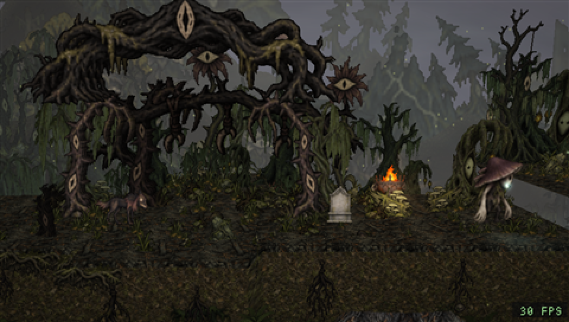 | 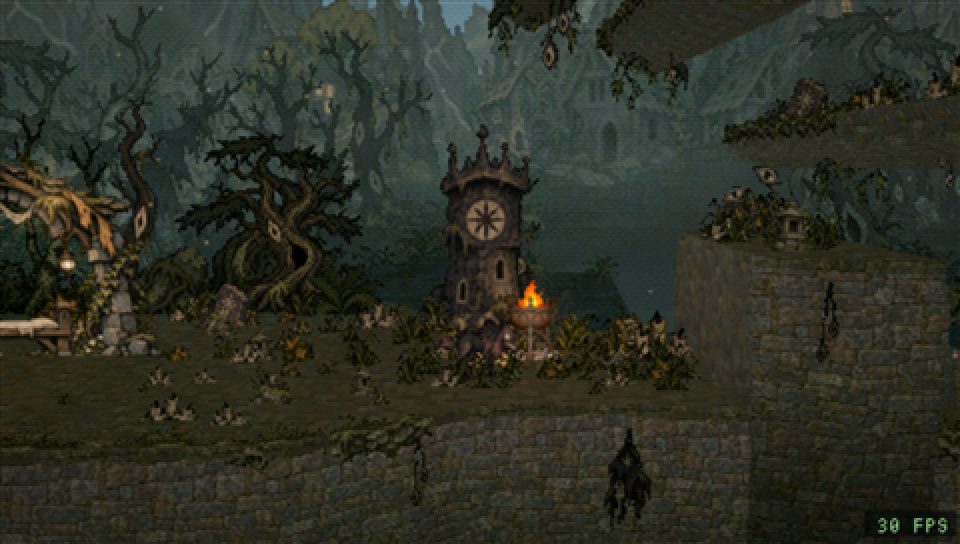 |
| 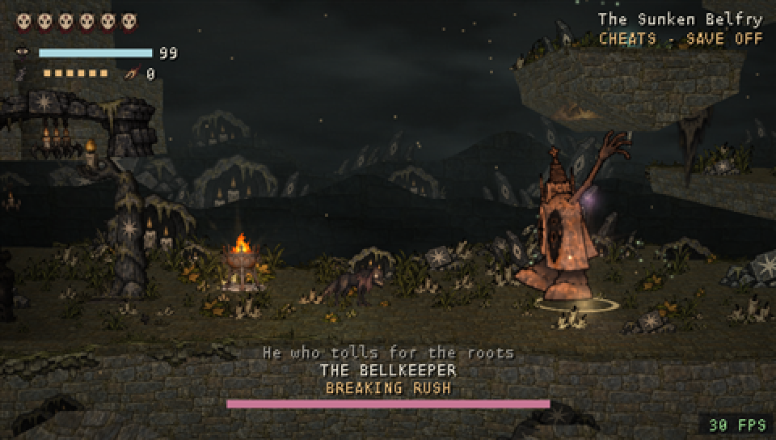 | 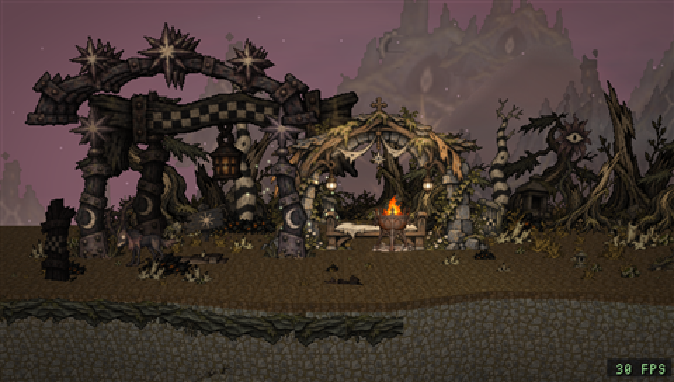 |
| 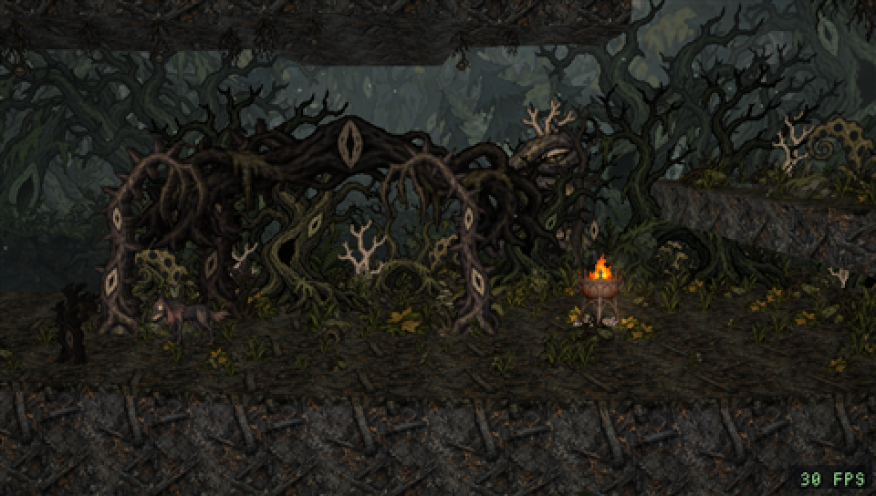 | 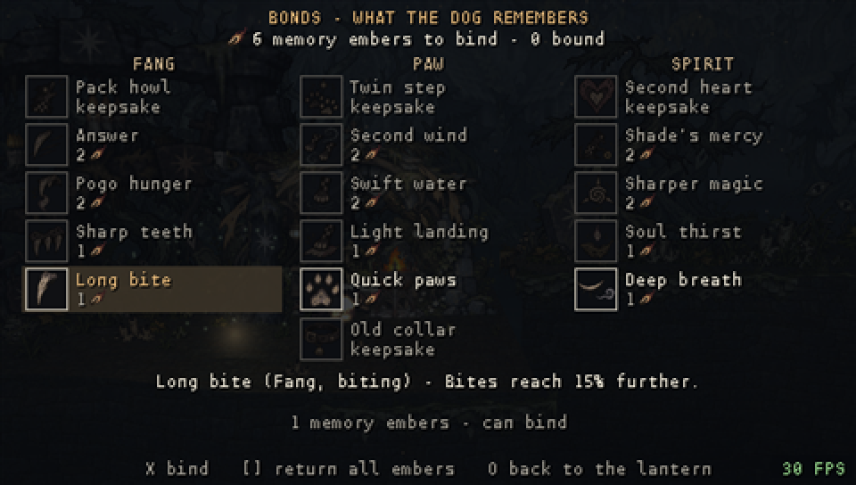 |

- 56 rooms in six areas, with doors that open as you find new abilities, items and the violet seal
- Five bosses with phases, and boss trials to fight them on their own
- Bonds: a tree of 17 memories to bind at the lantern refuges
- Cutscenes, and the web version's sound and music
- A GRAPHICS page (LEAN to FULL), an FPS counter, button remapping and assist options
- 30 fps on a real PSP-2000

**Requirements:** PSP-2000, PSP-3000 or PSP Go with custom firmware (the PSP-1000 is not supported), or PPSSPP. About
35 MB free.

**Install:** unzip and copy the `BeyondHollow` folder into `PSP/GAME`. You should have
`PSP/GAME/BeyondHollow/EBOOT.PBP` and `PSP/GAME/BeyondHollow/data/` (13 `.pak` files). When updating, keep
`data/save.bin` (your walk), `data/graphics.bin` and `data/options.bin` (your settings).

**Controls** (change them on the CONTROLS page): stick / D-pad move and aim (Up rests at a lantern), ✕ jump, □ bite,
○ dash, △ soul spell, R bark, hold L mend, L + R for the thread flight, Select map, Start pause.

The web version is still changing; this edition follows it and will be updated.

**AI use:** some sprite sheets were generated in bcaa777's drawing style, about 30 of the game's sounds were made
with ElevenLabs, and the code (this PSP port included) was written with AI help.

## Credits & license

*A Place Beyond* and *Beyond Hollow* — game, art and design: **bcaa777**.
The PSP editions are built with the open [PSPSDK toolchain](https://github.com/pspdev); third-party notices are in the
release zip (`THIRD_PARTY_NOTICES.txt`).

The games and all their content are © bcaa777. They are free to download and play — please share a link to this page
rather than re-uploading the files.
